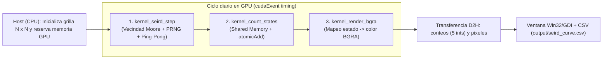

# Reporte de Actividad: Programación Paralela en GPU con CUDA

**Proyecto:** `SEIRD-CUDA-Basic` — Simulación epidemiológica 2D mediante Autómata Celular Estocástico  
**Tecnología / Arquitectura:** NVIDIA CUDA (arquitectura `sm_120`, GPU **NVIDIA GeForce RTX 5050 Laptop GPU**)  
**Código fuente:** [src/seird_basic.cu](src/seird_basic.cu)

---

## 1. Objetivo de la actividad

Ejemplificar el desarrollo y ejecución de **kernels paralelos en GPU** usando **CUDA** para resolver un problema computacional intensivo sobre una grilla 2D: la simulación estocástica del modelo epidemiológico **SEIRD** (*Susceptible, Exposed, Infected, Recovered, Dead*), comparando su rendimiento frente a una implementación secuencial equivalente en CPU y visualizando la evolución en tiempo real.

---

## 2. Entorno de hardware y software utilizado

| Componente | Especificación |
|---|---|
| **GPU** | NVIDIA GeForce RTX 5050 Laptop GPU (arquitectura Blackwell, `sm_120`) |
| **CUDA Toolkit** | CUDA 13.5 (`nvcc` V13.5.37) |
| **Compilador Host (C++17)** | Visual Studio 2022 Build Tools (MSVC `14.44.35207`, `x64`) |
| **Sistema Operativo** | Windows (ventana visual mediante Win32 / GDI) |
| **Script de compilación** | [build.bat](build.bat) |

Comando de compilación utilizado:
```bat
nvcc -std=c++17 -arch=sm_120 -O3 -Xcompiler "/EHsc /O2" src\seird_basic.cu -o build\seird_basic.exe -luser32 -lgdi32
```

---

## 3. Planteamiento del problema: Modelo SEIRD 2D

La población se modela como una grilla cuadrada de $N \times N$ celdas. Cada celda representa un individuo en uno de cinco estados posibles (`enum State : uint8_t` en [src/seird_basic.cu](src/seird_basic.cu#L32-L38)):

1. **S (`SUSCEPTIBLE = 0`)**: Individuo sano que puede contagiarse según sus 8 vecinos inmediatos (**vecindad de Moore**).
2. **E (`EXPOSED = 1`)**: Individuo contagiado en periodo de incubación (`t_inc = 3` días).
3. **I (`INFECTED = 2`)**: Individuo infeccioso durante `t_inf = 10` días.
4. **R (`RECOVERED = 3`)**: Individuo recuperado (inmune).
5. **D (`DEAD = 4`)**: Individuo fallecido (tasa de letalidad `alpha = 0.04`).

Para una celda susceptible con $k > 0$ vecinos infectados, la probabilidad diaria de contagio es:

$$p_{\text{infect}} = 1 - (1 - \beta)^k, \quad \text{con } \beta = 0.28$$

En la inicialización (`init_population`), se siembra 1 foco central de $5 \times 5$ celdas infectadas y 20 focos aleatorios adicionales para observar la propagación de múltiples ondas de contagio.

---

## 4. Diseño paralelo y kernels CUDA desarrollados

La ejecución en GPU organiza los hilos en bloques 2D de $16 \times 16$ (`dim3 block(16, 16)`, es decir, 256 hilos por bloque) sobre una grilla de $\lceil N/16 \rceil \times \lceil N/16 \rceil$ bloques, logrando un mapeo directo de **1 hilo por celda**.



### Kernel 1: `kernel_seird_step` ([líneas 60–119](src/seird_basic.cu#L60-L119))
- **Propósito:** Calcular el siguiente estado y temporizador de cada celda en paralelo.
- **Técnicas paralelas aplicadas:**
  - **Doble buffer (*ping-pong*):** Lee de `state_in` / `timer_in` y escribe en `state_out` / `timer_out`, evitando condiciones de carrera (*race conditions*) entre celdas vecinas que se leen y actualizan simultáneamente. Al finalizar cada día, el host intercambia los punteros con `std::swap`.
  - **PRNG por hilo (`xorshift32`):** Cada celda mantiene su propio estado pseudoaleatorio (`rng_states[idx]`) en memoria global mediante `rand_uniform`, evitando contención o serialización al generar números aleatorios en paralelo.
  - **Cualificadores `__restrict__`:** Permiten al compilador asumir que los punteros de entrada y salida no se solapan.

### Kernel 2: `kernel_count_states` ([líneas 124–146](src/seird_basic.cu#L124-L146))
- **Propósito:** Obtener el conteo diario total de los 5 estados (`S, E, I, R, D`).
- **Técnicas paralelas aplicadas:**
  - **Reducción en dos niveles con memoria compartida (`__shared__ int local_counts[5]`):**
    1. El hilo `(0, 0)` de cada bloque inicializa el arreglo compartido y sincroniza con `__syncthreads()`.
    2. Todos los hilos del bloque acumulan su estado en `local_counts[s]` usando `atomicAdd` en memoria compartida (mucho más rápida que la memoria global).
    3. Tras otro `__syncthreads()`, únicamente el hilo `(0, 0)` de cada bloque suma los totales locales al arreglo `global_counts` en memoria global. Esto reduce drásticamente las operaciones atómicas sobre memoria global.

### Kernel 3: `kernel_render_bgra` ([líneas 151–167](src/seird_basic.cu#L151-L167))
- **Propósito:** Convertir directamente en GPU la matriz de estados `uint8_t` a un framebuffer de píxeles `uint32_t` en formato `BGRA` (`0x00RRGGBB`) compatible con `StretchDIBits` de Windows GDI.
- **Código de colores:**
  - **S:** Azul oscuro (`0x00122040`)
  - **E:** Amarillo (`0x00F5C527`)
  - **I:** Rojo (`0x00E62E2D`)
  - **R:** Verde (`0x002ECC71`)
  - **D:** Gris oscuro (`0x003A3A40`)

---

## 5. Resultados experimentales (Benchmark CPU vs GPU)

Se ejecutó el modo `--bench` durante **200 días simulados** para tres tamaños de grilla en la **NVIDIA GeForce RTX 5050 Laptop GPU** (midiendo el tiempo de los kernels `kernel_seird_step` + `kernel_count_states` mediante `cudaEventElapsedTime` frente a `cpu_seird_step` secuencial cronometrado con `std::chrono::high_resolution_clock`):

| Tamaño de grilla | Celdas totales | Tiempo GPU (kernels) | Tiempo CPU (secuencial) | Speedup (CPU / GPU) |
|---:|---:|---:|---:|---:|
| `512 x 512` | 262,144 | 5.73 ms | 301.19 ms | **52.54x** |
| `1024 x 1024` | 1,048,576 | 15.01 ms | 1,304.48 ms | **86.89x** |
| `2048 x 2048` | 4,194,304 | 36.94 ms | 5,284.12 ms | **143.03x** |

> [!NOTE]
> El incremento del speedup conforme crece el tamaño de la grilla (de **52.54x** a **143.03x**) refleja la escalabilidad del paralelismo masivo en GPU: a mayor cantidad de celdas, mayor ocupación de los multiprocesadores de flujo (SM) y mejor amortización del costo de lanzamiento de los kernels.

---

## 6. Conclusiones para la exposición

1. **Adecuación del modelo al paralelismo SIMD/SIMT:** Los autómatas celulares 2D sobre grillas regulares se mapean de forma natural a CUDA asignando un hilo por celda, siempre que se respete la independencia de lectura/escritura mediante doble buffer (*ping-pong*).
2. **Importancia de la jerarquía de memoria:** El uso de `__shared__` en `kernel_count_states` evita que millones de hilos compitan por los mismos 5 contadores en memoria global.
3. **Portabilidad y diferencias frente a OpenCL:** En CUDA, la compilación estática dirigida a la arquitectura de la GPU (`-arch=sm_120`) permite generar código nativo optimizado mediante `nvcc` y aprovechar sintaxis concisa (`<<<grid, block>>>`), mientras que OpenCL prioriza la portabilidad entre fabricantes compilando los kernels en tiempo de ejecución mediante una API más verbosa de plataformas, dispositivos, contextos y colas de comandos.
